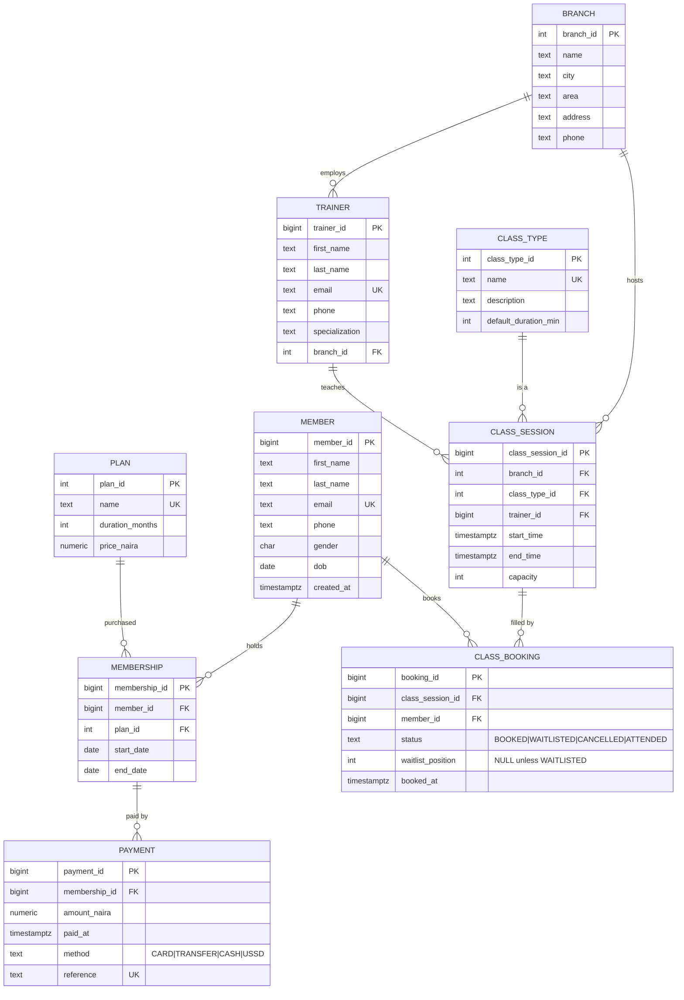

# ER diagram — IronCore Fitness

The diagram below is rendered by GitHub when this file is viewed on GitHub.com
(it is a ```mermaid fenced block). For local rendering, use any Markdown viewer
that supports Mermaid (VS Code Mermaid extension, Obsidian, Typora).



## Constraints summary

| # | Constraint | How it is enforced |
|---|---|---|
| 1 | Member cannot hold two overlapping memberships | `EXCLUDE USING gist (member_id =, daterange &&)` with `btree_gist` extension |
| 2 | Trainer cannot teach two overlapping classes | `EXCLUDE USING gist (trainer_id =, tstzrange &&)` |
| 3 | Member can book only with an active membership on class day | `BEFORE INSERT` trigger `check_membership_before_booking` |
| 4 | Booked places never exceed capacity; rest go on WAITLIST | `BEFORE INSERT` trigger `enforce_capacity` |
| 5 | Cancellation promotes waitlist position 1 | `AFTER UPDATE OF status` trigger `promote_waitlist` |
| 6 | One booking per member per class | `UNIQUE (class_session_id, member_id)` |
| 7 | Plan price and payment amount > 0 | `CHECK (price_naira > 0)`, `CHECK (amount_naira > 0)` |
| 8 | Status domain | `CHECK (status IN ('BOOKED','WAITLISTED','CANCELLED','ATTENDED'))` |
| 9 | `waitlist_position` only when WAITLISTED | `CHECK` rule on `class_booking` |

## Relational schema (textual, for the PDF appendix)

```
branch         (branch_id PK, name, city, area, address, phone)
member         (member_id PK, first_name, last_name, email UK, phone, gender, dob, created_at)
plan           (plan_id PK, name UK, duration_months, price_naira)
membership     (membership_id PK, member_id FK→member, plan_id FK→plan,
                start_date, end_date,
                EXCLUDE (member_id =, daterange(start_date,end_date) &&))
trainer        (trainer_id PK, first_name, last_name, email UK, phone, specialization, branch_id FK→branch)
class_type     (class_type_id PK, name UK, description, default_duration_min)
class_session  (class_session_id PK, branch_id FK, class_type_id FK, trainer_id FK,
                start_time, end_time, capacity,
                EXCLUDE (trainer_id =, tstzrange(start_time,end_time) &&))
class_booking  (booking_id PK, class_session_id FK, member_id FK, status, waitlist_position, booked_at,
                UNIQUE (class_session_id, member_id),
                CHECK status domain, CHECK waitlist_position NULL unless WAITLISTED)
payment        (payment_id PK, membership_id FK, amount_naira, paid_at, method, reference UK)
```
